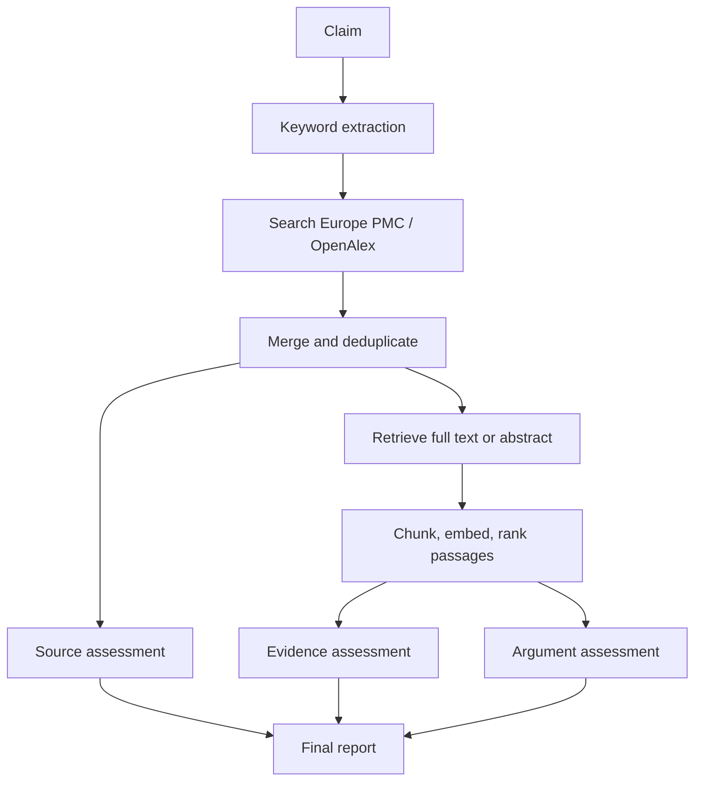

# AgentCT

**An agent for critical-thinking checks.** Given a claim, AgentCT retrieves scientific literature and reports how far the claim can be trusted, showing its reasoning and what it could not assess.

> **Status: experimental research prototype.** AgentCT is not a fact-checker. Its outputs are LLM-assisted estimates built on partial evidence, and the report states how much it could actually assess. Treat the results as a structured starting point for your own judgment.

## What it does

AgentCT assesses the epistemic quality of a claim against five criteria:

| Criterion | Question it asks | Status |
|---|---|---|
| **Source quality** | Who is saying it? Expertise, independence of the source, and agreement among expert sources | Implemented |
| **Evidence quality** | How strong is the underlying evidence? Study type, relevance, limitations | Implemented |
| **Argument quality** | Does the reasoning actually connect the evidence to the conclusion? | Implemented |
| **Plausibility** | Does the claim fit the best available knowledge? | Planned |
| **Metacognition** | Is confidence calibrated? Does the system recognise what it does not know? | Planned |

Where evidence is missing (for example, no full text could be retrieved), the relevant assessment is marked as not done or as abstract-only, instead of being filled in with a guess.

## How it works



The pipeline is a fixed [LangGraph](https://github.com/langchain-ai/langgraph) graph. Source assessment runs in parallel with the passage-retrieval branch, and the report waits for all three assessments.

### Design choices

- **A fixed graph, not a tool-calling agent loop.** The steps are known in advance, so a deterministic, inspectable pipeline is easier to debug and to trust than a model deciding what to do next.
- **Structured outputs.** Every LLM node returns a validated Pydantic schema.
- **Scores computed in code where possible.** The LLM rates individual items; numbers such as concordance and support are computed in Python from those ratings instead of being written by the model. This is done for source concordance and support, and for the evidence score. Other scores are still being moved over.
- **Graceful degradation.** Full text is fetched through the Europe PMC API when it is openly available. Otherwise assessment falls back to abstracts, and the output says so.
- **Shared passages.** Evidence and argument assessment read the same ranked passages, so they describe the same text.

## Limitations

- **Coverage is the main constraint.** Full text is mostly available for open-access biomedical papers. For other fields, assessment often rests on abstracts alone, which is shallower.
- **Scope.** The current retrieval focus is health and biomedical claims. Other domains work poorly.
- **LLM noise.** Scores can vary between runs on the same input, and a free-tier model is used for development.
- **Rate limits.** The free-tier LLM has per-minute token limits, so runs can be slow or need retries.
- **Not yet evaluated.** There is no benchmark of known-direction claims yet, so calibration is unmeasured.

## Quickstart

Requirements: Python 3.11 and a [Groq](https://console.groq.com) API key.

```bash
git clone https://github.com/marziof/AgentCT.git
cd AgentCT
python -m venv .venv && source .venv/bin/activate
pip install -r requirements.txt        # TODO: requirements.txt not yet in the repo
echo "GROQ_API_KEY=your_key_here" > .env
python scripts/test_graph.py           # prompts for a claim and runs the full graph
```

`scripts/` holds development and experiment scripts, not a finished interface. A hosted demo is planned (see the roadmap).

## Repository layout

```
src/agentct/
  graph.py         # LangGraph definition
  state.py         # shared graph state
  config.py        # model configuration
  nodes/           # retrieval, source, evidence, argument and report nodes
  retrieval/       # Europe PMC, OpenAlex, full text, chunking, embeddings
  models/          # Pydantic schemas
  utils/           # retry logic and scoring helpers
scripts/           # development and experiment scripts
```

## Roadmap

- [x] Retrieval pipeline with source, evidence and argument assessment
- [ ] Normalised source records; exclude sources without usable text from stance and concordance
- [ ] Coverage reporting in the final report (for example, "deep assessment based on N of M sources")
- [ ] Hosted demo (Hugging Face Space) with cached examples and bring-your-own-API-key for custom claims
- [ ] Evaluation set of claims with known direction, reported in this README
- [ ] Plausibility and metacognition criteria

## Example

<!-- Add one real run here: the claim, a short per-criterion summary, and the coverage line. -->

## Background

<!-- Optional: one line about the framework this implements, with a citation once the paper is available. Check with your co-author before naming anyone. -->

## License

<!-- Choose a license (for example MIT) and add a LICENSE file. -->
